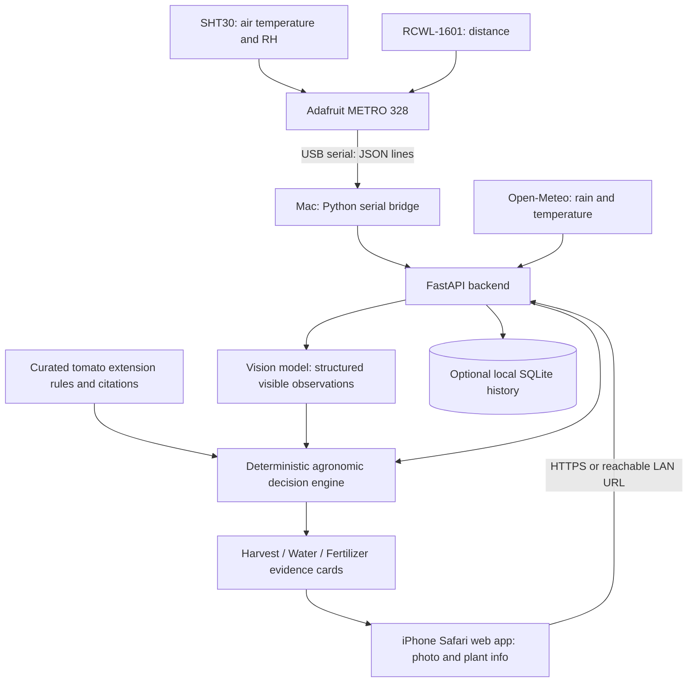

# FolLand AI — Multimodal Plant Monitoring Assistant

**Status:** Hackathon brainstorming + implementation-ready MVP specification (not a validated agronomic diagnostic system)  
**Updated:** November 7, 2026  
**Hardware now available:** Adafruit METRO 328, full-size breadboard, SHT30, RCWL-1601, iPhone camera, laptop/Mac  
**Target form factor:** Mobile-responsive **web application**, accessed through iPhone Safari  
**Initial crop:** Tomato (recommended pilot; expandable later)  
**Team:** Assign owners below

> **One-line pitch:** FolLand AI combines an iPhone plant photo, live air-temperature/humidity and ultrasonic distance from an Arduino-compatible board, local weather, and cited agronomic knowledge to provide transparent harvest, watering, and fertilization advisories.

## 0. Executive decision — what the team should build now

**Build a single-crop tomato MVP, not an all-crop diagnosis platform.** Demonstrate one full path from a photo and real/clearly labeled simulated sensor values to three recommendation cards, each showing the supporting evidence and what was *not measured*.

**Final recommended implementation:**

- **iPhone:** Safari web page captures/uploads a fruit image (optional separate leaf photo).
- **Hardware:** SHT30 and RCWL-1601 connect through a **breadboard to the available Adafruit METRO 328**.
- **Transport:** METRO 328 sends structured serial messages over **USB to a Mac/laptop**; it has **no onboard Wi-Fi**. Do not attempt to run AI inference, web hosting, or direct iPhone networking on the 2 KB RAM microcontroller.
- **Python service:** `pyserial` reads USB messages; **FastAPI** handles sensor state, photo uploads, weather, image analysis, and deterministic decision rules.
- **Frontend:** **React + Vite + Tailwind CSS** for a polished mobile web dashboard. If integration is running behind schedule, **Streamlit** is the fallback for speed.
- **Data:** Open-Meteo forecasts and a small manually curated, cited tomato-guidance file; avoid unrestricted live web scraping.
- **Presentation:** Harvest assessment is the primary live AI demonstration. Watering and fertilization are cautious advisories, not direct diagnoses.

### First 60–90 minutes — do these in order

1. **Identify sensor pin labels** and photograph both sides of the SHT30 and RCWL-1601. The RCWL-1601 comes in **TRIG/ECHO** and **I²C** variants; wiring is not interchangeable.
2. Connect METRO 328 to the Mac using a **micro-USB data cable**. In Arduino IDE select **Board → Arduino Uno**, select the detected serial port, and upload **File → Examples → 01.Basics → Blink**.
3. Install/test the **SHT30** with compatible breakout voltage and I²C wiring; verify real °C/RH readings over Serial Monitor.
4. Test the RCWL-1601 **alone**, using the correct wiring for its pin labels, before connecting both sensors.
5. Freeze a shared **sensor JSON schema** and use sample/mock messages so the frontend/backend can begin in parallel.
6. Build iPhone photo upload and display three recommendation cards; integrate real serial data when ready.
7. Test green/turning/red tomato photos and one blurry/out-of-scope photo. Record a backup demo.

**Not yet verified:** the exact SHT30 breakout board, the RCWL-1601 interface variant, presence of a compatible USB data cable/jumper wires, and whether the Mac and iPhone can share a reachable network. These affect exact wiring and deployment, but do not block the rest of the MVP.

## 1. Problem and opportunity

Small growers and hobby gardeners often make decisions from scattered cues: fruit color, leaf appearance, weather forecasts, and observations of soil conditions. General-purpose plant apps frequently return a label without clearly explaining which observations support it.

**Our idea:** Combine three evidence types in one interpretable screen:

1. **Observed:** iPhone camera photo, SHT30 ambient temperature and relative humidity, and RCWL-1601 ultrasonic distance.
2. **Context:** Crop/variety, growth stage, planting date (if known), location, manual soil check, and recent watering/fertilizer history.
3. **External evidence:** Weather forecasts/history and short, properly sourced university-extension crop guides.

The result is a practical **decision-support assistant**, not an automated diagnosis or a substitute for soil testing.

### The three questions the product answers

| Question | Realistic MVP answer | Important limitation |
|---|---|---|
| **Harvest now?** | Image-based tomato maturity stage (green, turning, red/ripe, uncertain) plus explanation | Color alone can be misleading for some tomato varieties; maturity, size, and intended use matter. |
| **Water now?** | Watering risk/advisory based on weather, leaf symptoms, and optional **manual soil moisture check** | Air relative humidity is **not** soil moisture; without a soil probe or manual check, do not give a definitive irrigation order. |
| **Fertilize now?** | Flag possible nutrient-stress patterns and recommend checking soil/plant history or obtaining soil test | Yellow/brown leaves can also be disease, excessive water, temperature, age, or light stress; no reliable N-P-K diagnosis from these sensors alone. |

**Primary differentiation:** Evidence traceability. Every suggestion should show exactly which inputs and which agricultural references contributed to it.

## 2. Hardware inventory and what it *actually* measures

| Component | Available? | Interface / specifications | Role in product | Limitation |
|---|---|---|---|---|
| **Adafruit METRO 328** | **Yes** | ATmega328P, 16 MHz, 32 KB flash, 2 KB RAM, Arduino Uno compatible; 5 V logic by default; CP2104 USB-to-serial interface | Poll sensors, serialize measurements over USB | No built-in Wi-Fi/Bluetooth; cannot run the AI model |
| **Full-size breadboard** | **Yes** | Passive prototyping board | Connect sensor pins, power rails, and ground without soldering if sensors have suitable headers | Does not provide power or process readings |
| **SHT30** | **Yes** | I²C air temperature + relative humidity; bare SHT30 supply range 2.15–5.5 V; nominal typical accuracy about ±0.2 °C / ±2 percentage points RH under specified conditions | Ambient microclimate input | **Not** soil-moisture or nutrient measurement; breakout's safe voltage is still unknown |
| **RCWL-1601** | **Yes** | Ultrasonic distance, nominal approx. 2–450 cm; best practical range stated by Adafruit approx. 10–250 cm; **interface variant not yet confirmed** | Optional fixed-geometry canopy/height proxy and visible live IoT demonstration | Not water, nutrient, fruit ripeness, or health sensor |
| **iPhone camera** | **Yes** | Web image capture/upload through Safari | Tomato ripeness and visible leaf symptom observations | Does not reveal soil/root/nutrient concentrations |
| **Mac/laptop** | **Available for build, exact model unimportant** | USB serial + Python server | Sensor bridge, model API orchestration, local development server | Must remain connected to the METRO for live data |

Verified primary references: [METRO 328](https://www.adafruit.com/product/2488), [METRO 328 detailed specifications](https://www.adafruit.com/product/50), [RCWL-1601 TRIG/ECHO, Adafruit #4007](https://www.adafruit.com/product/4007), [RCWL-1601 I²C, Adafruit #4742](https://www.adafruit.com/product/4742), [SHT30 by Sensirion](https://sensirion.com/products/catalog/SHT30-DIS-B).

### 2.1 Confirm the RCWL-1601 *before* applying power

There are at least two vendor-sold board configurations with the same RCWL-1601 family name:

| Visible pin labels | Adafruit example | Required communication | Safe plan with SHT30 |
|---|---|---|---|
| `VCC`, `TRIG`, `ECHO`, `GND` | [#4007](https://www.adafruit.com/product/4007) | Digital trigger pulse + timed echo | **Preferred:** D9/D10 for ultrasonic and A4/A5 for SHT30 I²C |
| `VCC`, `SCL`, `SDA`, `GND` | [#4742](https://www.adafruit.com/product/4742) | I²C at reported address `0x57` | **Caution:** Adafruit warns this model can lock up a shared I²C bus; test separately and do not promise simultaneous readings |

The exact board variant in your kit is **unconfirmed**. **Never** connect `TRIG`/`ECHO` wiring to pins labeled `SCL`/`SDA`.

### 2.2 Recommended wiring — RCWL-1601 **TRIG/ECHO** variant only

This table is valid **only if** your ultrasonic module is marked `VCC/TRIG/ECHO/GND` and the SHT30 breakout has been confirmed 5 V-compatible *on both power and I²C logic*.

| Sensor pin | METRO 328 pin | Notes |
|---|---|---|
| SHT30 `VCC`/`VIN` | `5V` **only if breakout explicitly supports 5 V** | Otherwise use appropriately shifted 3.3 V I²C, not unsafe direct 5 V bus levels |
| SHT30 `GND` | `GND` | Shared/common ground |
| SHT30 `SDA` | `SDA` or `A4` | Hardware I²C data |
| SHT30 `SCL` | `SCL` or `A5` | Hardware I²C clock |
| RCWL-1601 `VCC` | `5V` | Adafruit #4007 supports 3–5.5 V |
| RCWL-1601 `GND` | `GND` | Shared/common ground |
| RCWL-1601 `TRIG` | `D9` | GPIO output |
| RCWL-1601 `ECHO` | `D10` | GPIO input; 5 V METRO is compatible with the #4007 sensor when powered from 5 V |
| METRO USB | Mac USB port via **USB data cable** | Power + serial + sketch upload |

**SHT30 warning:** The **bare sensor's** 2.15–5.5 V supply specification is *not* proof that a particular breakout module can safely be attached to a 5 V I²C bus. Check its board markings and documentation. If it is 3.3 V logic only, add a bidirectional I²C level shifter or use a known 5 V-safe breakout. The METRO's `3V3` power output alone does **not** level-shift its SDA/SCL logic. Do not solder, power, or guess until the breakout is identified.

**Breadboard safety:** Power off before changing connections; ensure each power rail's voltage is measured/known; never bridge `5V` to `GND` or `3V3`; use shared GND; check pin orientation; verify modules have soldered headers/jumper wires; and keep water away from the electronics.

### 2.3 Alternative wiring — RCWL-1601 **I²C** variant

| I²C RCWL pin | METRO pin | Caveat |
|---|---|---|
| `VCC` | Compatible power rail | Confirm module rating |
| `GND` | `GND` | Common ground |
| `SDA` | `SDA` / `A4` | *Only in a separately tested bus setup* |
| `SCL` | `SCL` / `A5` | *Only in a separately tested bus setup* |

This I²C variant can fail when sharing a bus with SHT30; the METRO 328 has one main hardware I²C controller. First test each independently with an I²C scanner and example code. Even if both work alone, combined operation is **not validated**. For the hackathon, prioritize live SHT30 and show the ultrasonic channel as **unavailable** or explicitly **simulated** rather than destabilize the whole demo. A later hardware revision can use a separate controller/bus and validated isolation method.

### 2.4 Arduino IDE and USB setup (Mac)

1. Install [Arduino IDE](https://www.arduino.cc/en/software) and connect the METRO using a **micro-USB data cable**.
2. Select **Tools → Board → Arduino AVR Boards → Arduino Uno** (the METRO 328 ships with an Uno-compatible Optiboot bootloader).
3. Select **Tools → Port**. On macOS, it will often appear as `/dev/cu.SLAB_USBtoUART` or similar; **do not hard-code the name**.
4. Upload **File → Examples → 01.Basics → Blink**; verify the on-board LED flashes.
5. If no serial port appears, check cable/USB adapter; METRO versions with CP2104 may need the [Silicon Labs CP210x VCP driver](https://www.silabs.com/developer-tools/usb-to-uart-bridge-vcp-drivers) as advised by Adafruit.
6. Wire/test **SHT30 alone**, then **ultrasonic alone**, then connect both only after checking variant and voltage compatibility.
7. Open **Serial Monitor at 115200 baud** to confirm sensor output. **Close Serial Monitor before starting the Python bridge**, since both programs generally cannot own the same port simultaneously.

### 2.5 Distance-to-height estimation

With the ultrasonic transducer fixed directly above a plant and **a stable empty soil/base reading** `d_ref`, use a window of repeated distance measurements `d_1, …, d_n`:

```text
canopy_height_proxy_cm = d_ref_cm - median(valid_distances_cm)
```

This is a *rough canopy-height proxy*, not a precise biological growth measure. Reject out-of-range echoes, document fixed sensor-to-soil geometry, and never compare readings taken at different positions as plant growth. **Ultrasonic measurement is a supporting visualization, not an input for tomato ripeness or nutrient diagnosis.**

### 2.6 Minimal demonstration firmware — **only for TRIG/ECHO RCWL**

Requires the **Adafruit SHT31 Library** in Arduino IDE's Library Manager (compatible with the SHT30 family) and an electrically compatible SHT30 breakout. This is **starter code** for a verified TRIG/ECHO module; it has **not been tested on your particular physical kit**.

```cpp
#include <Wire.h>
#include <Adafruit_SHT31.h>
#include <math.h>

Adafruit_SHT31 sht = Adafruit_SHT31();
const int TRIG_PIN = 9;
const int ECHO_PIN = 10;

void setup() {
  Serial.begin(115200);
  Wire.begin();
  pinMode(TRIG_PIN, OUTPUT);
  pinMode(ECHO_PIN, INPUT);
  digitalWrite(TRIG_PIN, LOW);
  if (!sht.begin(0x44) && !sht.begin(0x45)) {
    Serial.println("{\"status\":\"sht30_not_found\"}");
  }
}

void loop() {
  float temperature = sht.readTemperature();
  float humidity = sht.readHumidity();

  digitalWrite(TRIG_PIN, LOW);
  delayMicroseconds(2);
  digitalWrite(TRIG_PIN, HIGH);
  delayMicroseconds(10);
  digitalWrite(TRIG_PIN, LOW);
  unsigned long durationUs = pulseIn(ECHO_PIN, HIGH, 30000UL);
  float distanceCm = durationUs > 0 ? durationUs * 0.0343f / 2.0f : NAN;

  Serial.print("{\"source\":\"metro328\",\"uptime_ms\":");
  Serial.print(millis());
  Serial.print(",\"air_temperature_c\":");
  if (isnan(temperature)) Serial.print("null"); else Serial.print(temperature, 2);
  Serial.print(",\"air_relative_humidity_pct\":");
  if (isnan(humidity)) Serial.print("null"); else Serial.print(humidity, 2);
  Serial.print(",\"ultrasonic_distance_cm\":");
  if (isnan(distanceCm) || distanceCm < 2 || distanceCm > 450) Serial.print("null");
  else Serial.print(distanceCm, 2);
  Serial.println("}");
  delay(2000);
}
```

The ultrasonic conversion assumes an approximate speed of sound (343 m/s near room temperature). Temperature compensation and median filtering are upgrades; do not claim this simple measurement is precision-calibrated. `null` is preferable to a misleading zero reading.

### 2.7 Computer-side Python serial bridge

Install `pip install pyserial` in the backend's Python environment. Use a program like this to read each line and timestamp it on the laptop (the METRO does not provide a wall-clock timestamp):

```python
import json
from datetime import datetime, timezone
import serial

PORT = "/dev/cu.SLAB_USBtoUART"  # replace with the actual detected port

with serial.Serial(PORT, 115200, timeout=2) as arduino:
    while True:
        line = arduino.readline().decode("utf-8", errors="replace").strip()
        if not line:
            continue
        try:
            reading = json.loads(line)
        except json.JSONDecodeError:
            continue
        if reading.get("source") != "metro328":
            continue
        reading["received_at_utc"] = datetime.now(timezone.utc).isoformat()
        reading["data_mode"] = "live"
        print(reading)  # production: persist latest reading for GET /api/sensors/latest
```

**Implementation note:** `serial_bridge.py` can run as a background thread/process in the Python backend and share its latest validated reading with FastAPI. On serial disconnect, mark the feed **stale/unavailable**; do not silently reuse old measurements as if live.

## 3. Recommended use case: tomatoes first

Tomatoes give the strongest visual demonstration because color changes during ripening are visible. A user selects **tomato**, takes a fruit photo, and receives one of four outputs:

- **Likely harvest-ready** — fruit appears to have reached the target ripeness for the user-selected harvest goal.
- **Approaching harvest** — some color change; inspect again later.
- **Not yet ready** — fruit appears immature.
- **Uncertain / retake photo** — occlusion, glare, cultivar, or model ambiguity.

**Never label a green tomato automatically unripe** without checking cultivar and harvest purpose. University of Minnesota Extension recommends considering usable size and color and notes that some mature-green tomatoes can ripen indoors: [Growing tomatoes](https://extension.umn.edu/garden-and-home/yard-and-garden/gardening-in-minnesota/growing-tomatoes).

A second photo showing the **leaves** can generate a visible-stress note: e.g., *yellowing is visible; possible causes include nutrient deficiency, aging, too much water, or disease; further checks needed.* Never claim a measured nitrogen concentration.

## 4. Proposed end-to-end product experience

1. **Select crop / profile:** crop=tomato; optional variety, planting date, pot vs garden bed, location, harvest target (eat today vs transport/store), and last watering/fertilization date.
2. **Capture/upload image:** iPhone Safari can open a responsive web page and use its photo/file picker; no native iOS app is required.
3. **Read sensors:** SHT30 reports temperature and ambient RH; RCWL-1601 reports distance (and possible fixed-geometry height proxy).
4. **Fetch weather:** read recent rainfall, forecast rain, forecast temperature, possibly evapotranspiration from Open-Meteo.
5. **Analyze images:** identify crop/fruit, visible maturity stage, leaf appearance, image quality, and uncertainty; request a clearer picture if necessary.
6. **Apply crop-specific decision rules:** combine observations and weather with cited agronomy guidance; distinguish `observed`, `estimated`, and `not measured`.
7. **Show recommendation card:** Harvest / Water / Fertilizer as separate sections with **recommendation**, **evidence**, **limits**, and **next check**.
8. **Optional history:** save readings/photos by plant ID to display changes over time.

### Demo example (illustrative, NOT real readings)

**Input:** Tomato image showing substantial red color; air 24.1°C; RH 61%; sensor distance 32.5 cm; recent rain low; user says soil is dry ~5 cm below the surface.

**Output:**

- **Harvest:** `Likely ready` — fruit has visible mature-red coloration; verify target variety and fruit firmness manually.
- **Water:** `Check / likely water` — user reports dry soil at ~5 cm, and the weather information is consistent with dryness. Water roots if soil remains dry; do not infer dryness from 61% air RH.
- **Fertilizer:** `Insufficient evidence` — no soil test, known feeding history, or diagnostic leaf finding.
- **Confidence:** qualitative `high / medium / low` for the **visual stage**, not invented percentage certainty. Explanations should cite data and rules.

## 5. System architecture — revised for the METRO 328



**Network boundaries:** Sensors are **not** wireless and do **not** send readings directly to an iPhone. The Mac reads USB data and serves/hosts the application. When testing on iPhone, `localhost` on the phone is *not* the Mac. Use a reachable Mac LAN IP on the same non-isolated network or a secure deployment/tunnel. A photo upload via an HTML file input works in mobile Safari; direct camera-stream access through `getUserMedia()` generally requires a secure HTTPS origin, so **use an image file-picker/camera capture upload for the MVP**. Some campus/guest Wi-Fi networks isolate devices; verify connectivity early and prepare a laptop-hosted fallback demo.

### 5.1 Module ownership and technologies

| Module | Responsible for | Technology | Acceptance test |
|---|---|---|---|
| `sensors/firmware/` | Poll SHT30 and **identified** RCWL-1601 interface; emit newline-delimited JSON | Arduino IDE / C++ on METRO 328 | Valid serial measurements with explicit `null` when unavailable |
| `sensors/serial_bridge.py` | Read the Mac's USB serial device; attach UTC receipt time and freshness | Python + `pyserial` | Live reading becomes stale when unplugged |
| `backend/app.py` | Expose sensor/photo APIs; combine inputs and start analysis | FastAPI, Uvicorn | End-to-end `POST /api/analyze` succeeds |
| `backend/image_analysis.py` | Structured vision observations | Hosted vision API or constrained simple fallback | Distinguishes example green/turning/red images and abstains on bad photos |
| `backend/weather.py` | Fetch/cache rain forecast/history | Open-Meteo | Forecast includes time, location, and source attribution |
| `backend/decision_engine.py` | Conservative evidence-linked crop guidance | Python rules | Missing soil test never generates an exact fertilizer dose |
| `frontend/` | Camera upload, crop selection, three cards, provenance, freshness | React + Vite + Tailwind CSS | Works on iPhone Safari and laptop |
| `knowledge/` | Crop rule citations/conditions | Small reviewed JSON | Every advice card traces to specific evidence/reference |

### 5.2 Suggested HTTP and serial contracts

| Endpoint/transport | Data | Notes |
|---|---|---|
| **USB serial**: newline JSON | `air_temperature_c`, `air_relative_humidity_pct`, `ultrasonic_distance_cm`, `uptime_ms`, `source` | Measured at METRO; no location/time-of-day stored in MCU |
| **GET `/api/sensors/latest`** | Last reading + `received_at_utc`, `data_mode`, `fresh` | If stale, return explicit unavailable status; require reasonable validation |
| **GET `/api/weather?latitude=…&longitude=…`** | Forecast/history + source + retrieval time | Coordinates supplied from user-approved crop location; optional demo default labeled |
| **POST `/api/analyze`** | `multipart/form-data`: `image` + crop, optional variety, soil check, location, harvest goal | Backend obtains latest *server-side* sensor data, image analysis and weather |
| **GET `/api/health`** | Backend/sensor/vision/weather availability | Useful during judging/demo |

**Example live sensor line** (illustrative schema, **not a real measurement**):

```json
{"source":"metro328","uptime_ms":120500,"air_temperature_c":24.10,"air_relative_humidity_pct":61.00,"ultrasonic_distance_cm":32.50}
```

**Example normalized `GET /api/sensors/latest`** (synthetic):

```json
{
  "source": "metro328",
  "data_mode": "live",
  "received_at_utc": "2026-11-07T20:19:00+00:00",
  "fresh": true,
  "air_temperature_c": 24.1,
  "air_relative_humidity_pct": 61.0,
  "ultrasonic_distance_cm": 32.5
}
```

For a disconnected sensor: `fresh: false`, with the last receipt time or `null`; for a mock demo: `data_mode: "simulated"` prominently shown in the dashboard. **Never describe synthetic values as live evidence.**

**Illustrative `POST /api/analyze` form fields:**

```text
image: <uploaded image JPEG/PNG/HEIC if decoding supported>
crop: tomato
variety: unknown
harvest_goal: eat_now
soil_check: dry_at_5cm | moist | wet | unknown
latitude, longitude: optional, user-provided
```

**Illustrative recommendation response** (schema rather than actual inference):

```json
{
  "crop": "tomato",
  "visual_observations": {"maturity_stage": "red", "photo_quality": "usable"},
  "sensor_data_mode": "live",
  "harvest": {
    "status": "likely_ready",
    "evidence": ["visible red fruit", "user harvest goal: eat now"],
    "limitation": "variety and firmness not verified"
  },
  "watering": {
    "status": "check_and_likely_water",
    "evidence": ["user reports dry soil at 5 cm"],
    "limitation": "no soil moisture sensor; air RH is not soil RH"
  },
  "fertilizer": {
    "status": "insufficient_evidence",
    "evidence": [],
    "limitation": "no soil test or nutrient concentration measured"
  },
  "references": [{"title": "University of Minnesota Extension tomato guide", "url": "https://extension.umn.edu/garden-and-home/yard-and-garden/gardening-in-minnesota/growing-tomatoes"}]
}
```

The vision model describes **visible** traits. The Python rules decide whether an action is supportable; a language model may summarize evidence but must **not** invent live readings, nutrient concentrations, yield, or references.

## 6. Agricultural knowledge and open data

| Source | Data/use case | Access and caveats | Priority |
|---|---|---|---|
| [Open-Meteo](https://open-meteo.com/en/docs) | Hourly/daily temperature, precipitation forecast and recent weather; selected evapotranspiration and modeled soil conditions | API key not required for noncommercial use under published limits; **modeled soil moisture is regional, not a reading in a particular pot**; attribute CC BY 4.0 data | **MVP** |
| [University of Minnesota Extension: tomatoes](https://extension.umn.edu/garden-and-home/yard-and-garden/gardening-in-minnesota/growing-tomatoes) | Ripeness and watering guidance | Curate short rules and cite source; avoid presenting guidance as universal for all climates/cultivars | **MVP** |
| [University of Minnesota Extension: watering vegetables](https://extension.umn.edu/garden-and-home/yard-and-garden/gardening-in-minnesota/watering-the-vegetable-garden) | Soil-check procedure and water-demand context | Advises checking soil below surface; cannot be replaced by ambient RH | **MVP** |
| [Penn State Extension: diagnosing poor plant health](https://extension.psu.edu/diagnosing-poor-plant-health) | Differential causes for yellowing/wilting | Multiple causes overlap; make cautious suggestions, not single-cause diagnoses | **MVP** |
| [NASA POWER](https://power.larc.nasa.gov/docs/services/api/temporal/daily/) | Historical solar and meteorological time series | Better for longer-term crop modeling than rapid live demos | Stretch |
| [USDA NRCS Web Soil Survey](https://www.nrcs.usda.gov/resources/data-and-reports/web-soil-survey) | Regional mapped soils and properties | Map units do not directly measure the soil in an individual pot; U.S. coverage | Stretch |
| [PlantDoc](https://github.com/pratikkayal/PlantDoc-Dataset) | Real-world-like leaf disease image dataset | Disease classes, **not** validated nutrient levels/fruit ripeness; confirm image/licence restrictions before reuse | Stretch |
| [PlantVillage](https://github.com/spMohanty/PlantVillage-Dataset) | Large disease image benchmark | Controlled backgrounds can make field accuracy much worse; dataset licensing is version-dependent | Stretch |

**Knowledge approach for hackathon:** Build a small, reviewable set of crop-specific rules with `source_title`, `source_url`, `retrieved_at`, `applicability`, and `cautions`. This is safer, faster, and more testable than unrestricted web search on every request. A retrieval-augmented generation (RAG) component could be added only after the pipeline works reliably.

**Sample weather call** (substitute the user's approximate crop location):

```text
https://api.open-meteo.com/v1/forecast?latitude=43.0&longitude=-78.8&daily=precipitation_sum,temperature_2m_max,temperature_2m_min&hourly=relative_humidity_2m,temperature_2m&timezone=auto
```

This is an API **request format**, not a verified reading at the time of the demo. Historical rain may need a past-days option or historical endpoint, depending on the chosen metric.

## 7. Decision logic and scientific guardrails

### Harvest advisory

1. Crop/profile must match supported crop; otherwise `unsupported_crop`.
2. Reject low-quality images (blurred, distant fruit, very poor lighting) with `retake_photo`.
3. Return visually assessed maturity category and cited cultivar-specific caution.
4. If image category is clearly mature and user goal matches it, label `likely_ready`; if ambiguous, `inspect_manually`.
5. Never predict a precise harvest date without a calibrated crop-growth model.

### Watering advisory

1. Use any **user-provided physical soil check** as the most direct evidence currently available.
2. Use visible wilting, weather history, forecast rain, and air temperature/RH as context, not proof of soil dryness.
3. If no soil evidence, output `check_soil_before_watering`, not `definitely_water`.
4. If soggy soil/waterlogging suspected, flag potential overwatering rather than recommending more water.
5. **Optional upgrade:** a capacitive soil-moisture sensor materially improves direct watering assessment if properly calibrated for the growing medium.

### Fertilizer advisory

1. Visual symptoms may suggest possible stress, but are **not specific** to nutrient deficiency.
2. Ask for fertilizing history, crop stage, leaf position, soil pH/test results, and whether water/drainage problems exist.
3. If evidence is insufficient, output `insufficient_evidence` and suggest a soil test / local extension guidance.
4. Do not claim to measure N, P, K or prescribe precise application rates without suitable evidence.

### Confidence and transparency

- Display **data freshness** and whether a value is `measured`, `reported by user`, `forecast/model`, or `AI observation`.
- Do **not** display unsupported claims like `97% chance fertilizer needed`.
- If using a model probability, label it **model confidence** and calibrate/evaluate it before interpreting it as real-world probability.
- Surface alternative possible explanations of visual symptoms.

## 8. Hackathon MVP: scope and priorities

| Rank | Deliverable | Acceptance criterion | Demo importance (team estimate, not measured) |
|---|---|---|---|
| P0 | **Phone photo -> harvest-stage explanation** | Upload 3 distinct tomato photos (green, turning, red) and receive sensible differentiated explanations | Very high |
| P0 | **Sensor readings visible in app** | METRO 328 → USB serial → Mac → app; live SHT30 temperature/RH and RCWL distance when the correct module variant works; units and freshness | Very high |
| P0 | **Weather integration** | API returns a local forecast, including rain; clearly shows source/time | High |
| P0 | **Evidence-based recommendation cards** | Harvest, watering, fertilization each shown with limits; never fabricate soil measurements | Very high |
| P1 | **Manual soil check input** | Toggle or short selector for damp/dry/unknown; impacts watering result | High |
| P1 | **Cited agricultural references** | Each major conclusion links to a relevant extension article | Medium |
| P1 | **Fallback / mock mode** | App still demos with clearly labeled synthetic sensor data if hardware fails | High |
| P2 | **Ultrasonic height history** | Fixed mount, repeatable readings on same plant across time | Medium |
| P2 | **Disease dataset training, RAG, multiple crops, native iOS app** | Only if core flow already stable | Low for initial demo |

**Do not build:** autonomous fertilizer dispensing, disease certainty, NPK estimates from a photo, yield forecasts, all-crop support, or a full custom-trained foundation model during the initial hackathon.

## 9. Suggested team split (adapt to actual team size)

| Workstream | Owner | Interfaces / task |
|---|---|---|
| Hardware / sensor | Member 1 | METRO 328 Arduino firmware, verify sensor variants and wiring, stream USB-serial JSON, implement mock fallback |
| Computer vision / ML | Member 2 | Define structured image labels, image quality checks, tomato maturity demo cases |
| Backend / rules / data | Member 3 | Weather API, agronomic rules with citations, uncertainty and recommendation JSON |
| Frontend / demo / integration | Member 4 | iPhone-friendly upload flow, dashboard, tests, screenshots, demo storyline |

For a 2–3 person team, merge frontend/backend or vision/rules roles. Assign one person **integration ownership** even if responsibilities overlap.

**Critical dependency:** Hardware and frontend development run **in parallel**. Do not wait for the ultrasonic sensor to work before the image/decision pipeline is usable. The sole hardware gate before applying power is confirming the **actual pin labels and SHT30 breakout voltage tolerance**.

### Suggested 24-hour work plan

| Elapsed time | Outcome |
|---|---|
| 0–2 h | Agree crop, demo story, JSON schema, repo tasks and UI sketch |
| 2–6 h | Frontend iPhone photo upload; METRO Blink and USB-serial bring-up or labeled mock; weather endpoint |
| 6–10 h | Structured visual observation + deterministic rules + data-source links |
| 10–14 h | Integrate end-to-end; test green/turning/red fruit photos; manual soil input |
| 14–18 h | Fix failures, improve clarity, add crop profile and robust fallback |
| 18–21 h | Test phone/browser, calibrate sensor handling, finalize safety/evidence language |
| 21–24 h | Lock demo, record short backup video, rehearse judging Q&A, README polish |

Times are **planning allocations**, not estimates based on observed team performance. Protect the last ~3 hours for integration and demo reliability.

## 10. Suggested GitHub project structure

```text
cropsense-ai/
├── README.md                  # This proposal, evolving into setup + demo guide
├── docs/
│   ├── DECISIONS.md            # Scope and architecture decisions
│   ├── SCIENCE_LIMITATIONS.md  # Measured vs inferred, uncertainties
│   └── DEMO.md                 # Step-by-step presentation script
├── frontend/
│   └── ...                     # React/Vite/Tailwind mobile web app
├── backend/
│   ├── app.py                 # FastAPI endpoints
│   ├── image_analysis.py
│   ├── decision_engine.py
│   └── weather.py
├── sensors/
│   ├── firmware/
│   │   └── metro328.ino       # Arduino Uno-compatible METRO firmware
│   ├── serial_bridge.py       # pyserial on Mac/laptop
│   └── mock_sensor.json       # Clearly flagged simulated data
├── knowledge/
│   ├── tomato_rules.json
│   └── sources.md
├── tests/
│   ├── test_sensor_parser.py  # Serial JSON/null and freshness
│   ├── test_harvest.py
│   ├── test_watering.py
│   └── test_missing_data.py
└── .env.example               # Names only; never commit secrets
```

**GitHub coordination:** create 4 workstream issues, assign owners, open PRs against a shared `main`, and ensure each module implements the agreed request/output contract. Keep API keys server-side in environment variables; **never commit keys or user photos** unless consent is explicit.

## 11. Testing and evaluation

### Demo test matrix

| Test | Expected behavior |
|---|---|
| Clear red tomato photo | Suggest likely harvest-ready, with cultivar caveat |
| Clear green tomato photo | Not definitely ready; identify possible mature-green/variety exception |
| Blurry/no-fruit photo | `retake_photo` or `uncertain`, not a fake confident result |
| Dry manual soil check + low recent rain | Conditional watering suggestion, explicitly based on user's manual check |
| Air RH high but soil check dry | Do not claim wet soil from high air RH |
| Yellow leaf photo, no soil test | Possible causes; **no exact fertilizer or nutrient prescription** |
| Weather API unavailable | State data is unavailable; provide limited offline output |
| Sensor disconnected | Mark `fresh=false` or show *simulated* prominently; never fabricate live readings |
| I²C ultrasonic variant + SHT30 share bus | Check bus lockup; disable ultrasonic channel rather than risk all sensor data |
| SHT30 breakout is 3.3 V-only | Do not direct-wire 5 V I²C without validated level shifting |
| Unfixed ultrasonic geometry | Do not display apparent plant growth as if measured accurately |

### Evaluation metrics (must be measured, not invented)

- **Image-stage agreement:** correct visual maturity labels / total manually labeled sample photos.
- **Abstention quality:** does the system decline to decide on ambiguous or out-of-scope photos?
- **Sensor reliability:** successful reads / attempted reads, latency and out-of-range count.
- **End-to-end latency:** photo submitted to finished result, measured in seconds.
- **Evidence coverage:** proportion of recommendation cards with traceable input and cited source.
- **Offline behavior:** number of scenarios that still produce a transparently limited answer.

No target accuracy or business-impact number should be claimed without an actual evaluation dataset and test results.

## 12. Main risks and mitigations

| Risk | Severity | Mitigation |
|---|---|---|
| Incorrect watering inference from air humidity | **Critical** | Require manual soil check or probe; show uncertainty |
| Incorrect nutrient diagnosis from leaf image | **Critical** | Show differential causes; defer fertilizer dose to soil testing / expert advice |
| METRO/USB integration failure | High | Check USB data cable and CP2104 port; test Blink/serial early; clearly labeled simulated values |
| Vision hallucination / image ambiguity | High | Structured labels, image-quality gate, do not infer invisible properties |
| Ultrasonic false growth claims | Medium | Fixed mounting, median of samples, timestamp and source flag |
| Inconsistent data/time/location | Medium | Record units, timezone, retrieval time, coordinates and source type |
| Scope creep | High | Single crop, 3 outcomes, one end-to-end demo |
| Third-party dataset/image rights | Medium | Track licenses; use team-owned demo photos where possible |

## 13. Judges' demo (2–3 minutes)

1. **Problem (15 s):** Knowing when to harvest or intervene requires more than one image or sensor.
2. **Photo scan (30 s):** Upload a tomato picture from an iPhone and show the visual maturity stage.
3. **Live IoT input (25 s):** Show ambient temp/RH and distance updating; explain they are not direct soil moisture or nutrient measurements.
4. **Open data fusion (30 s):** Display recent/forecast rain and reference link; enter manual soil dry/wet check.
5. **Three recommendation cards (35 s):** Harvest likely ready; watering check; fertilizer insufficient evidence where applicable.
6. **Why it matters / roadmap (20 s):** Interpretable, multimodal decisions today; add a calibrated soil moisture probe, additional crops, longitudinal validation later.

**Suggested demo sentence:** “We do not pretend that air humidity tells us how wet the soil is. Our system exposes what is measured, what is inferred, and what still needs a human check.”

## 14. Immediate team decisions and acceptance checklist

### Confirm / decide (do this at the start)

- [x] **Microcontroller selected:** Adafruit METRO 328 — Arduino Uno-compatible, **USB serial to Mac**.
- [x] **Prototyping platform:** Full-size breadboard.
- [x] **Other input devices:** SHT30, RCWL-1601, iPhone camera.
- [x] **Application form:** Mobile-responsive **web app**, not native iOS.
- [ ] Confirm the **RCWL-1601 pin labels**: `TRIG/ECHO` vs `SCL/SDA`.
- [ ] Identify exact **SHT30 breakout voltage and I²C pull-up compatibility**.
- [ ] Verify micro-USB **data** cable, jumper wires, and any necessary header pins/level shifter.
- [ ] Verify Mac USB serial port and Blink sketch; run sensors individually.
- [ ] Lock **tomato-only** as the first crop for the judges' demo.
- [ ] Obtain several **team-owned tomato photos**: green, turning, red, blurry and a leaf condition.
- [ ] Agree on `GET /api/sensors/latest`, `POST /api/analyze`, and explicit `live` vs `simulated` labels.
- [ ] Decide how to obtain soil check (`dry_at_5cm`, `moist`, `wet`, `unknown`) without a soil sensor.
- [ ] Test iPhone Safari access to the app over the actual demo network; prepare fallback.

### Definition of done for hackathon submission

The team can demonstrate a **single working walkthrough**: take/upload an iPhone photo → retrieve genuine *or clearly labeled simulated* sensor data → fetch a cited Open-Meteo forecast → produce the three understandable recommendation cards → explain both the evidence and the limitations. Have a backup recording in case of Wi-Fi, USB, model API, or sensor failure.

## 15. Future roadmap after hackathon

**V1:** Add calibrated capacitive soil moisture probe and plant-specific threshold calibration, with better irrigation advice.  
**V2:** Repeated fixed-geometry observations, growth trends, weather-aware alerts, and plant history.  
**V3:** More crops and variety-specific maturity benchmarks validated on field photos.  
**V4:** Soil-test integration, calibrated risk prediction, expert-reviewed agronomy rules and field trials.

---

## Source references (checked November 7, 2026)

1. Adafruit, [METRO 328 with headers](https://www.adafruit.com/product/2488) and [METRO 328 product specifications](https://www.adafruit.com/product/50) — ATmega328P, Arduino Uno selection, USB serial/CP2104, 5 V logic, memory and micro-USB power.
2. Adafruit, [RCWL-1601 TRIG/ECHO (#4007)](https://www.adafruit.com/product/4007) — ultrasonic range, voltage and trigger/echo interface.
3. Adafruit, [RCWL-1601 I²C (#4742)](https://www.adafruit.com/product/4742) — separate I²C variant; warned bus-sharing problems.
4. Sensirion, [SHT30-DIS-B product specifications](https://sensirion.com/products/catalog/SHT30-DIS-B) — typical RH/temperature accuracy, voltage, I²C.
5. University of Minnesota Extension, [Growing tomatoes in home gardens](https://extension.umn.edu/garden-and-home/yard-and-garden/gardening-in-minnesota/growing-tomatoes) — harvest and watering guidance.
6. University of Minnesota Extension, [Watering the vegetable garden](https://extension.umn.edu/garden-and-home/yard-and-garden/gardening-in-minnesota/watering-the-vegetable-garden) — manual soil checks.
7. Penn State Extension, [Diagnosing poor plant health](https://extension.psu.edu/diagnosing-poor-plant-health) — overlapping symptoms and differential causes.
8. Penn State Extension, [Diagnosing common problems in the vegetable garden](https://extension.psu.edu/diagnosing-common-problems-in-the-vegetable-garden) — disease/soil-test caution.
9. Open-Meteo, [Weather forecast API and documentation](https://open-meteo.com/en/docs) — forecast/weather data, free noncommercial terms, and CC BY 4.0 attribution.
10. NASA POWER, [Daily API documentation](https://power.larc.nasa.gov/docs/services/api/temporal/daily/) — optional historical agroclimatic data.
11. USDA NRCS, [Web Soil Survey](https://www.nrcs.usda.gov/resources/data-and-reports/web-soil-survey) — mapped soil information.
12. PlantDoc, [Original dataset repository](https://github.com/pratikkayal/PlantDoc-Dataset) — optional leaf-disease image research.
13. Open-Meteo, [pricing and usage terms](https://open-meteo.com/en/pricing) and [terms](https://open-meteo.com/en/terms) — free noncommercial API use, attribution and limits.
14. Silicon Labs, [CP210x USB-to-UART VCP drivers](https://www.silabs.com/developer-tools/usb-to-uart-bridge-vcp-drivers) — driver link if a METRO serial port does not enumerate.
15. Adafruit, [5 V-to-3 V I²C level shifter guide](https://learn.adafruit.com/adafruit-qt-5v-to-3v-shifter-breakout/wiring) — a compatible solution when a breakout is not 5 V I²C safe.

**Licensing note:** Each third-party dataset and external image has its own terms. Linking to source articles for evidence does not grant permission to republish their images or full text.
