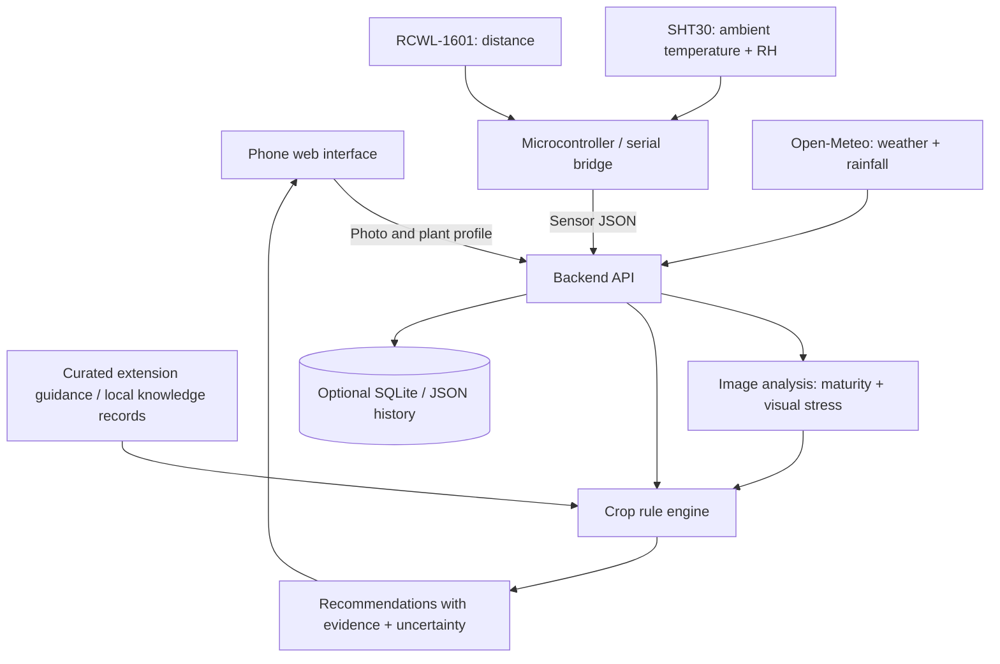

# CropSense AI — Multimodal Plant Monitoring Assistant

**Status:** Hackathon brainstorming / proposed MVP (not a validated agronomic diagnostic system)  
**Last researched:** November 7, 2026  
**Team:** TBD  
**Initial crop:** Tomato (recommended pilot; expandable to other crops)

> **One-line pitch:** Use a phone photo, real-time air temperature/humidity, ultrasonic distance, and local weather plus cited agricultural guidance to explain whether a crop appears ready to harvest and what checks to make before watering or fertilizing.

## 1. Problem and opportunity

Small growers and hobby gardeners often make decisions from scattered cues: fruit color, leaf appearance, weather forecasts, and observations of soil conditions. General-purpose plant apps frequently return a label without clearly explaining which observations support it.

**Our idea:** Combine three evidence types in one interpretable screen:

1. **Observed:** iPhone camera photo, SHT30 ambient temperature and relative humidity, and RCWL-1601 ultrasonic distance.
2. **Context:** Crop/variety, growth stage, planting date (if known), location, manual soil check, and recent watering/fertilizer history.
3. **External evidence:** Weather forecasts/history and short, properly sourced university-extension crop guides.

The result is a practical **decision-support assistant**, not an automated diagnosis or a substitute for soil testing.

### The three questions the product answers

| Question | Realistic MVP answer | Important limitation |
|---|---|---|
| **Harvest now?** | Image-based tomato maturity stage (green, turning, red/ripe, uncertain) plus explanation | Color alone can be misleading for some tomato varieties; maturity, size, and intended use matter. |
| **Water now?** | Watering risk/advisory based on weather, leaf symptoms, and optional **manual soil moisture check** | Air relative humidity is **not** soil moisture; without a soil probe or manual check, do not give a definitive irrigation order. |
| **Fertilize now?** | Flag possible nutrient-stress patterns and recommend checking soil/plant history or obtaining soil test | Yellow/brown leaves can also be disease, excessive water, temperature, age, or light stress; no reliable N-P-K diagnosis from these sensors alone. |

**Primary differentiation:** Evidence traceability. Every suggestion should show exactly which inputs and which agricultural references contributed to it.

## 2. Hardware inventory and what it *actually* measures

| Component | Interface/measurement | Verified specification | Product role | Does **not** measure |
|---|---|---|---|---|
| **RCWL-1601** ultrasonic range finder | Trigger/echo pulse; line-of-sight distance | 3.0–5.5 V; nominal distance about **2–450 cm**; vendor advises **10–250 cm** for best results; HC-SR04-compatible interface | Optional canopy-height / plant-growth trend **only if** mounted in a repeatable fixed position with a known reference | Nutrients, water in soil, fruit ripeness, health, direct plant height from arbitrary handheld angle |
| **SHT30** (SHT3x family) | I²C; ambient temperature and relative humidity | Sensor supply 2.15–5.5 V; typical humidity accuracy **±2 percentage points RH**; typical temperature accuracy **±0.2°C** (specified conditions) | Microclimate context; trends and alerts | Soil moisture, pH, N-P-K, water stress with certainty |
| **iPhone camera** | JPEG/HEIC image via browser upload | Depends on iPhone model and lighting; no fixed precision claimed | Visible fruit/leaf inspection, approximate maturity stage and visible anomalies | Root health, nutrients or soil moisture directly |
| **Microcontroller** (not listed as available) | ESP32 / Raspberry Pi Pico / Arduino or another compatible board | **To be confirmed** | Required for convenient SHT30 and RCWL-1601 digital readout; send JSON via USB/BLE/Wi-Fi | — |

**Source:** [Adafruit RCWL-1601](https://www.adafruit.com/product/4007) and [Sensirion SHT30](https://sensirion.com/products/catalog/SHT30-DIS-B).

**Wiring plan (if a 3.3 V ESP32/Pico is available):** SHT30 SDA/SCL to compatible I²C pins; RCWL-1601 TRIG/ECHO to digital pins; common GND. Check the **specific breakout board**, pinout, bus pull-ups and voltage/logic compatibility before powering. Do not assume a 5 V echo output is safe for a 3.3 V input. Sample sensors every 5–10 s, filter noisy distance readings, and send structured JSON.

**Distance/height method:** Mount the sensor downward on a fixed frame. If the sensor-to-soil distance with no plant is `d_ref` and the sensor-to-top-of-canopy reading is `d_t`, then:

`h_est(t) = d_ref - median(d_t measurements)`

This is an **approximate canopy-height proxy**, not an exact biological plant-height measure. Leaves can deflect/miss the ultrasonic beam, multiple plants can interfere, and a nonfixed phone/sensor cannot reliably track growth. With a one-day hackathon, keep height as a supplemental demo, not part of core harvest scoring.

## 3. Recommended use case: tomatoes first

Tomatoes give the strongest visual demonstration because color changes during ripening are visible. A user selects **tomato**, takes a fruit photo, and receives one of four outputs:

- **Likely harvest-ready** — fruit appears to have reached the target ripeness for the user-selected harvest goal.
- **Approaching harvest** — some color change; inspect again later.
- **Not yet ready** — fruit appears immature.
- **Uncertain / retake photo** — occlusion, glare, cultivar, or model ambiguity.

**Never label a green tomato automatically unripe** without checking cultivar and harvest purpose. University of Minnesota Extension recommends considering usable size and color and notes that some mature-green tomatoes can ripen indoors: [Growing tomatoes](https://extension.umn.edu/garden-and-home/yard-and-garden/gardening-in-minnesota/growing-tomatoes).

A second photo showing the **leaves** can generate a visible-stress note: e.g., *yellowing is visible; possible causes include nutrient deficiency, aging, too much water, or disease; further checks needed.* Never claim a measured nitrogen concentration.

## 4. Proposed end-to-end product experience

1. **Select crop / profile:** crop=tomato; optional variety, planting date, pot vs garden bed, location, harvest target (eat today vs transport/store), and last watering/fertilization date.
2. **Capture/upload image:** iPhone Safari can open a responsive web page and use its photo/file picker; no native iOS app is required.
3. **Read sensors:** SHT30 reports temperature and ambient RH; RCWL-1601 reports distance (and possible fixed-geometry height proxy).
4. **Fetch weather:** read recent rainfall, forecast rain, forecast temperature, possibly evapotranspiration from Open-Meteo.
5. **Analyze images:** identify crop/fruit, visible maturity stage, leaf appearance, image quality, and uncertainty; request a clearer picture if necessary.
6. **Apply crop-specific decision rules:** combine observations and weather with cited agronomy guidance; distinguish `observed`, `estimated`, and `not measured`.
7. **Show recommendation card:** Harvest / Water / Fertilizer as separate sections with **recommendation**, **evidence**, **limits**, and **next check**.
8. **Optional history:** save readings/photos by plant ID to display changes over time.

### Demo example (illustrative, NOT real readings)

**Input:** Tomato image showing substantial red color; air 24.1°C; RH 61%; sensor distance 32.5 cm; recent rain low; user says soil is dry ~5 cm below the surface.

**Output:**

- **Harvest:** `Likely ready` — fruit has visible mature-red coloration; verify target variety and fruit firmness manually.
- **Water:** `Check / likely water` — user reports dry soil at ~5 cm, and the weather information is consistent with dryness. Water roots if soil remains dry; do not infer dryness from 61% air RH.
- **Fertilizer:** `Insufficient evidence` — no soil test, known feeding history, or diagnostic leaf finding.
- **Confidence:** qualitative `high / medium / low` for the **visual stage**, not invented percentage certainty. Explanations should cite data and rules.

## 5. System architecture



### Modules and interfaces

| Module | Responsibility | Suggested implementation |
|---|---|---|
| Frontend | Mobile-first camera upload, input forms, result screen | Streamlit for fastest implementation; or React/Vite if a frontend developer is available |
| Sensor ingestion | Read temperature, RH, distance; validate timestamps/units | ESP32/Pico Arduino-style firmware + serial JSON bridge; mock endpoint until hardware works |
| Backend | Orchestrate photo, context, sensors, weather, rules | Python FastAPI or Streamlit server-side functions |
| Image analyzer | Return structured visual observations, not freeform instructions | Multimodal vision API if available; fallback to human labels or lightweight classifier |
| Weather adapter | Precipitation/temperature forecast, last-days weather | Open-Meteo REST API with timeouts and cache |
| Knowledge base | Curated per-crop rules and cited text | `knowledge/tomato_rules.json`, references in Markdown |
| Decision engine | Combine observations and mark missing evidence | Deterministic Python rules; optional LLM **only to explain** |
| Storage | Keep plant profile and photo/reading history | In-memory dictionary or SQLite for MVP |

**Design principle:** An AI model should describe **what is visible**. A deterministic rule layer decides what is justified from available evidence; a language model may summarize but must not invent readings, references, or fertilizer doses.

### Example `POST /analyze` JSON contract (illustrative)

```json
{
  "plant_id": "demo-tomato-01",
  "crop": "tomato",
  "variety": null,
  "growth_stage": "fruiting",
  "photo_type": "fruit",
  "observations": {
    "air_temperature_c": 24.1,
    "air_relative_humidity_pct": 61.0,
    "ultrasonic_distance_cm": 32.5,
    "soil_dry_at_5cm": true,
    "soil_moisture_pct": null
  },
  "weather": {
    "rain_last_7d_mm": 3.2,
    "rain_next_24h_mm": 0.5,
    "source": "open-meteo"
  }
}
```

In implementation, upload the image as a multipart file or URL linked to the request rather than embedding an entire image in JSON.

### Example normalized analysis output

```json
{
  "crop": "tomato",
  "image": {
    "fruit_ripeness_stage": "red",
    "visible_leaf_yellowing": null,
    "image_quality": "usable",
    "uncertainty": "medium"
  },
  "harvest": {
    "status": "likely_ready",
    "evidence": ["visible red fruit", "crop profile: tomato"],
    "limitations": ["variety and firmness not confirmed"]
  },
  "watering": {
    "status": "check_and_likely_water",
    "evidence": ["manual soil check: dry at 5 cm", "low recent precipitation"],
    "limitations": ["no direct soil moisture sensor"]
  },
  "fertilizer": {
    "status": "insufficient_evidence",
    "evidence": [],
    "limitations": ["no soil test or nutrient measurement"]
  },
  "references": [
    {
      "title": "Growing tomatoes in home gardens",
      "url": "https://extension.umn.edu/garden-and-home/yard-and-garden/gardening-in-minnesota/growing-tomatoes"
    }
  ]
}
```

All numerical values in these examples are **synthetic demo data**, not sensor observations or validated thresholds.

## 6. Agricultural knowledge and open data

| Source | Data/use case | Access and caveats | Priority |
|---|---|---|---|
| [Open-Meteo](https://open-meteo.com/en/docs) | Hourly/daily temperature, precipitation forecast and recent weather; selected evapotranspiration and modeled soil conditions | API key not required for noncommercial use under published limits; **modeled soil moisture is regional, not a reading in a particular pot**; attribute CC BY 4.0 data | **MVP** |
| [University of Minnesota Extension: tomatoes](https://extension.umn.edu/garden-and-home/yard-and-garden/gardening-in-minnesota/growing-tomatoes) | Ripeness and watering guidance | Curate short rules and cite source; avoid presenting guidance as universal for all climates/cultivars | **MVP** |
| [University of Minnesota Extension: watering vegetables](https://extension.umn.edu/garden-and-home/yard-and-garden/gardening-in-minnesota/watering-the-vegetable-garden) | Soil-check procedure and water-demand context | Advises checking soil below surface; cannot be replaced by ambient RH | **MVP** |
| [Penn State Extension: diagnosing poor plant health](https://extension.psu.edu/diagnosing-poor-plant-health) | Differential causes for yellowing/wilting | Multiple causes overlap; make cautious suggestions, not single-cause diagnoses | **MVP** |
| [NASA POWER](https://power.larc.nasa.gov/docs/services/api/temporal/daily/) | Historical solar and meteorological time series | Better for longer-term crop modeling than rapid live demos | Stretch |
| [USDA NRCS Web Soil Survey](https://www.nrcs.usda.gov/resources/data-and-reports/web-soil-survey) | Regional mapped soils and properties | Map units do not directly measure the soil in an individual pot; U.S. coverage | Stretch |
| [PlantDoc](https://github.com/pratikkayal/PlantDoc-Dataset) | Real-world-like leaf disease image dataset | Disease classes, **not** validated nutrient levels/fruit ripeness; confirm image/licence restrictions before reuse | Stretch |
| [PlantVillage](https://github.com/spMohanty/PlantVillage-Dataset) | Large disease image benchmark | Controlled backgrounds can make field accuracy much worse; dataset licensing is version-dependent | Stretch |

**Knowledge approach for hackathon:** Build a small, reviewable set of crop-specific rules with `source_title`, `source_url`, `retrieved_at`, `applicability`, and `cautions`. This is safer, faster, and more testable than unrestricted web search on every request. A retrieval-augmented generation (RAG) component could be added only after the pipeline works reliably.

**Sample weather call** (substitute the user's approximate crop location):

```text
https://api.open-meteo.com/v1/forecast?latitude=43.0&longitude=-78.8&daily=precipitation_sum,temperature_2m_max,temperature_2m_min&hourly=relative_humidity_2m,temperature_2m&timezone=auto
```

This is an API **request format**, not a verified reading at the time of the demo. Historical rain may need a past-days option or historical endpoint, depending on the chosen metric.

## 7. Decision logic and scientific guardrails

### Harvest advisory

1. Crop/profile must match supported crop; otherwise `unsupported_crop`.
2. Reject low-quality images (blurred, distant fruit, very poor lighting) with `retake_photo`.
3. Return visually assessed maturity category and cited cultivar-specific caution.
4. If image category is clearly mature and user goal matches it, label `likely_ready`; if ambiguous, `inspect_manually`.
5. Never predict a precise harvest date without a calibrated crop-growth model.

### Watering advisory

1. Use any **user-provided physical soil check** as the most direct evidence currently available.
2. Use visible wilting, weather history, forecast rain, and air temperature/RH as context, not proof of soil dryness.
3. If no soil evidence, output `check_soil_before_watering`, not `definitely_water`.
4. If soggy soil/waterlogging suspected, flag potential overwatering rather than recommending more water.
5. **Optional upgrade:** a capacitive soil-moisture sensor materially improves direct watering assessment if properly calibrated for the growing medium.

### Fertilizer advisory

1. Visual symptoms may suggest possible stress, but are **not specific** to nutrient deficiency.
2. Ask for fertilizing history, crop stage, leaf position, soil pH/test results, and whether water/drainage problems exist.
3. If evidence is insufficient, output `insufficient_evidence` and suggest a soil test / local extension guidance.
4. Do not claim to measure N, P, K or prescribe precise application rates without suitable evidence.

### Confidence and transparency

- Display **data freshness** and whether a value is `measured`, `reported by user`, `forecast/model`, or `AI observation`.
- Do **not** display unsupported claims like `97% chance fertilizer needed`.
- If using a model probability, label it **model confidence** and calibrate/evaluate it before interpreting it as real-world probability.
- Surface alternative possible explanations of visual symptoms.

## 8. Hackathon MVP: scope and priorities

| Rank | Deliverable | Acceptance criterion | Demo importance (team estimate, not measured) |
|---|---|---|---|
| P0 | **Phone photo -> harvest-stage explanation** | Upload 3 distinct tomato photos (green, turning, red) and receive sensible differentiated explanations | Very high |
| P0 | **Sensor readings visible in app** | Live or serial-connected SHT30 temperature/RH; RCWL-1601 distance with units and timestamps | Very high |
| P0 | **Weather integration** | API returns a local forecast, including rain; clearly shows source/time | High |
| P0 | **Evidence-based recommendation cards** | Harvest, watering, fertilization each shown with limits; never fabricate soil measurements | Very high |
| P1 | **Manual soil check input** | Toggle or short selector for damp/dry/unknown; impacts watering result | High |
| P1 | **Cited agricultural references** | Each major conclusion links to a relevant extension article | Medium |
| P1 | **Fallback / mock mode** | App still demos with clearly labeled synthetic sensor data if hardware fails | High |
| P2 | **Ultrasonic height history** | Fixed mount, repeatable readings on same plant across time | Medium |
| P2 | **Disease dataset training, RAG, multiple crops, native iOS app** | Only if core flow already stable | Low for initial demo |

**Do not build:** autonomous fertilizer dispensing, disease certainty, NPK estimates from a photo, yield forecasts, all-crop support, or a full custom-trained foundation model during the initial hackathon.

## 9. Suggested team split (adapt to actual team size)

| Workstream | Owner | Interfaces / task |
|---|---|---|
| Hardware / sensor | Member 1 | Read SHT30 and RCWL-1601, choose microcontroller, stream JSON, implement mock mode |
| Computer vision / ML | Member 2 | Define structured image labels, image quality checks, tomato maturity demo cases |
| Backend / rules / data | Member 3 | Weather API, agronomic rules with citations, uncertainty and recommendation JSON |
| Frontend / demo / integration | Member 4 | iPhone-friendly upload flow, dashboard, tests, screenshots, demo storyline |

For a 2–3 person team, merge frontend/backend or vision/rules roles. Assign one person **integration ownership** even if responsibilities overlap.

### Suggested 24-hour work plan

| Elapsed time | Outcome |
|---|---|
| 0–2 h | Agree crop, demo story, JSON schema, repo tasks and UI sketch |
| 2–6 h | Frontend photo upload; sensor reader or labeled mock; weather endpoint |
| 6–10 h | Structured visual observation + deterministic rules + data-source links |
| 10–14 h | Integrate end-to-end; test green/turning/red fruit photos; manual soil input |
| 14–18 h | Fix failures, improve clarity, add crop profile and robust fallback |
| 18–21 h | Test phone/browser, calibrate sensor handling, finalize safety/evidence language |
| 21–24 h | Lock demo, record short backup video, rehearse judging Q&A, README polish |

Times are **planning allocations**, not estimates based on observed team performance. Protect the last ~3 hours for integration and demo reliability.

## 10. Suggested GitHub project structure

```text
cropsense-ai/
├── README.md                  # This proposal, evolving into setup + demo guide
├── docs/
│   ├── DECISIONS.md            # Scope and architecture decisions
│   ├── SCIENCE_LIMITATIONS.md  # Measured vs inferred, uncertainties
│   └── DEMO.md                 # Step-by-step presentation script
├── frontend/
│   └── ...                     # Streamlit or React client
├── backend/
│   ├── app.py
│   ├── image_analysis.py
│   ├── decision_engine.py
│   └── weather.py
├── sensors/
│   ├── firmware/              # Microcontroller code (if available)
│   ├── serial_bridge.py
│   └── mock_sensor.json
├── knowledge/
│   ├── tomato_rules.json
│   └── sources.md
├── tests/
│   ├── test_harvest.py
│   ├── test_watering.py
│   └── test_missing_data.py
└── .env.example               # Names only; never commit secrets
```

**GitHub coordination:** create 4 workstream issues, assign owners, open PRs against a shared `main`, and ensure each module implements the agreed request/output contract. Keep API keys server-side in environment variables; **never commit keys or user photos** unless consent is explicit.

## 11. Testing and evaluation

### Demo test matrix

| Test | Expected behavior |
|---|---|
| Clear red tomato photo | Suggest likely harvest-ready, with cultivar caveat |
| Clear green tomato photo | Not definitely ready; identify possible mature-green/variety exception |
| Blurry/no-fruit photo | `retake_photo` or `uncertain`, not a fake confident result |
| Dry manual soil check + low recent rain | Conditional watering suggestion, explicitly based on user's manual check |
| Air RH high but soil check dry | Do not claim wet soil from high air RH |
| Yellow leaf photo, no soil test | Possible causes; **no exact fertilizer or nutrient prescription** |
| Weather API unavailable | State data is unavailable; provide limited offline output |
| Sensor disconnected | Show unavailable or clearly labeled mock values, not fabricated live readings |
| Unfixed ultrasonic geometry | Do not display apparent plant growth as if measured accurately |

### Evaluation metrics (must be measured, not invented)

- **Image-stage agreement:** correct visual maturity labels / total manually labeled sample photos.
- **Abstention quality:** does the system decline to decide on ambiguous or out-of-scope photos?
- **Sensor reliability:** successful reads / attempted reads, latency and out-of-range count.
- **End-to-end latency:** photo submitted to finished result, measured in seconds.
- **Evidence coverage:** proportion of recommendation cards with traceable input and cited source.
- **Offline behavior:** number of scenarios that still produce a transparently limited answer.

No target accuracy or business-impact number should be claimed without an actual evaluation dataset and test results.

## 12. Main risks and mitigations

| Risk | Severity | Mitigation |
|---|---|---|
| Incorrect watering inference from air humidity | **Critical** | Require manual soil check or probe; show uncertainty |
| Incorrect nutrient diagnosis from leaf image | **Critical** | Show differential causes; defer fertilizer dose to soil testing / expert advice |
| Hardware integration failure | High | Mock input mode; test USB serial early; fallback screenshots |
| Vision hallucination / image ambiguity | High | Structured labels, image-quality gate, do not infer invisible properties |
| Ultrasonic false growth claims | Medium | Fixed mounting, median of samples, timestamp and source flag |
| Inconsistent data/time/location | Medium | Record units, timezone, retrieval time, coordinates and source type |
| Scope creep | High | Single crop, 3 outcomes, one end-to-end demo |
| Third-party dataset/image rights | Medium | Track licenses; use team-owned demo photos where possible |

## 13. Judges' demo (2–3 minutes)

1. **Problem (15 s):** Knowing when to harvest or intervene requires more than one image or sensor.
2. **Photo scan (30 s):** Upload a tomato picture from an iPhone and show the visual maturity stage.
3. **Live IoT input (25 s):** Show ambient temp/RH and distance updating; explain they are not direct soil moisture or nutrient measurements.
4. **Open data fusion (30 s):** Display recent/forecast rain and reference link; enter manual soil dry/wet check.
5. **Three recommendation cards (35 s):** Harvest likely ready; watering check; fertilizer insufficient evidence where applicable.
6. **Why it matters / roadmap (20 s):** Interpretable, multimodal decisions today; add a calibrated soil moisture probe, additional crops, longitudinal validation later.

**Suggested demo sentence:** “We do not pretend that air humidity tells us how wet the soil is. Our system exposes what is measured, what is inferred, and what still needs a human check.”

## 14. Decisions the team should make immediately

- [ ] Choose **tomato-only MVP** or one other specific crop with clear photo evidence.
- [ ] Confirm available microcontroller and whether it supports the SHT30 and RCWL-1601.
- [ ] Choose **Streamlit** (faster) or React + FastAPI (greater UI flexibility).
- [ ] Choose vision approach: hosted multimodal model, existing classifier, or rule-based color observations for first demo.
- [ ] Secure 3–6 **own** reference photos including immature/midstage/ripe and one blurry case.
- [ ] Decide how to input/check the soil condition manually, since no soil sensor is listed.
- [ ] Agree on a shared JSON interface before coding in parallel.
- [ ] Keep a mock-data backup; test actual iPhone Safari upload.

## 15. Future roadmap after hackathon

**V1:** Add calibrated capacitive soil moisture probe and plant-specific threshold calibration, with better irrigation advice.  
**V2:** Repeated fixed-geometry observations, growth trends, weather-aware alerts, and plant history.  
**V3:** More crops and variety-specific maturity benchmarks validated on field photos.  
**V4:** Soil-test integration, calibrated risk prediction, expert-reviewed agronomy rules and field trials.

---

## Source references (checked November 7, 2026)

1. Adafruit, [RCWL-1601 ultrasonic distance sensor](https://www.adafruit.com/product/4007) — supply voltage, interface and range.
2. Sensirion, [SHT30-DIS-B product specifications](https://sensirion.com/products/catalog/SHT30-DIS-B) — typical RH/temperature accuracy, voltage, I²C.
3. University of Minnesota Extension, [Growing tomatoes in home gardens](https://extension.umn.edu/garden-and-home/yard-and-garden/gardening-in-minnesota/growing-tomatoes) — harvest and watering guidance.
4. University of Minnesota Extension, [Watering the vegetable garden](https://extension.umn.edu/garden-and-home/yard-and-garden/gardening-in-minnesota/watering-the-vegetable-garden) — manual soil checks.
5. Penn State Extension, [Diagnosing poor plant health](https://extension.psu.edu/diagnosing-poor-plant-health) — overlapping symptoms and differential causes.
6. Penn State Extension, [Diagnosing common problems in the vegetable garden](https://extension.psu.edu/diagnosing-common-problems-in-the-vegetable-garden) — disease/soil-test caution.
7. Open-Meteo, [Weather forecast API and documentation](https://open-meteo.com/en/docs) — forecast/weather data and terms.
8. NASA POWER, [Daily API documentation](https://power.larc.nasa.gov/docs/services/api/temporal/daily/) — optional historical agroclimatic data.
9. USDA NRCS, [Web Soil Survey](https://www.nrcs.usda.gov/resources/data-and-reports/web-soil-survey) — mapped soil information.
10. PlantDoc, [Original dataset repository](https://github.com/pratikkayal/PlantDoc-Dataset) — optional leaf-disease image research.

**Licensing note:** Each third-party dataset and external image has its own terms. Linking to source articles for evidence does not grant permission to republish their images or full text.
